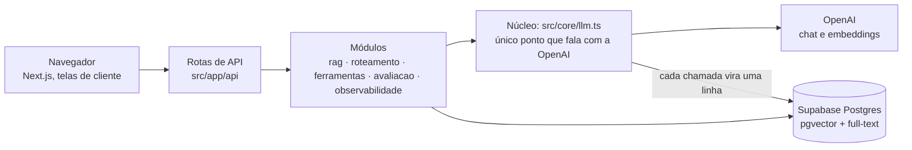

# Industrial AI Intelligence: documentação do sistema

Assistente de IA para **gestão de projetos de capital**. Ele lê os documentos e os
dados de uma obra industrial (cronograma, custos, riscos, relatórios, atas) e as
Normas Regulamentadoras, responde ao gerente do projeto citando a fonte e mostra,
em cada resposta, quanto custou, quanto demorou e se acertou.

O projeto foi feito para demonstrar, uma a uma, as técnicas que um engenheiro de
IA usa em produção: RAG com busca híbrida e reranking, roteamento de modelos,
function calling, avaliação com LLM-as-a-Judge e observabilidade de custo,
latência e qualidade.

> Números desta documentação: medidos em 16/11/2026 no próprio sistema.

---

## Sumário

1. [O problema e o cenário](#1-o-problema-e-o-cenário)
2. [Arquitetura](#2-arquitetura)
3. [O caminho de uma pergunta](#3-o-caminho-de-uma-pergunta)
4. [Módulos](#4-módulos)
5. [Núcleo: o cliente único do modelo](#5-núcleo-o-cliente-único-do-modelo)
6. [Dados e banco](#6-dados-e-banco)
7. [Modelos e custos](#7-modelos-e-custos)
8. [Métricas medidas](#8-métricas-medidas)
9. [Interface](#9-interface)
10. [Decisões e alternativas descartadas](#10-decisões-e-alternativas-descartadas)
11. [Limitações conhecidas e próximos passos](#11-limitações-conhecidas-e-próximos-passos)
12. [Roteiro de demonstração](#12-roteiro-de-demonstração)
13. [Perguntas prováveis numa entrevista](#13-perguntas-prováveis-numa-entrevista)

---

## 1. O problema e o cenário

Projetos de capital (implantação ou expansão de plantas industriais, portos,
infraestrutura) custam centenas de milhões de reais e costumam terminar atrasados
e acima do orçamento. A informação para antecipar isso existe, mas está espalhada:
o cronograma diz uma coisa, o relatório mensal outra, o risco que vai estourar o
prazo está numa planilha, a decisão do comitê está numa ata.

O sistema usa um **projeto fictício**, o **Projeto Linha 3**: a expansão de uma
planta de pelotização da Mineração Serra Azul (empresa inventada). Documentos de
obra reais são confidenciais; o projeto foi inventado com números consistentes
entre os documentos e os dados estruturados, para a avaliação conseguir conferir
se a resposta acertou.

| Dado do cenário | Valor |
|---|---|
| Orçamento aprovado (BAC) | R$ 480 milhões, mais R$ 36 milhões de contingência |
| Data de corte | 30/10/2026 |
| Avanço físico | 61% realizado contra 68% planejado |
| SPI / CPI | 0,897 (crítico) / 0,921 (alerta) |
| Estimativa no término (EAC) | R$ 521,3 milhões: estouro de R$ 41,3 milhões, maior que a contingência |
| Partida da nova linha | Linha de base em junho/2027; previsão atual em setembro/2027 |

**O que é real:** as 9 Normas Regulamentadoras (texto oficial do gov.br), os
modelos da OpenAI, o banco vetorial no Supabase, e o custo e a latência medidos
de cada chamada.
**O que é simulado:** o Projeto Linha 3, as empresas, e os dados de cronograma,
custos, riscos e pedidos de mudança que o agente consulta.

---

## 2. Arquitetura



- **Telas** (`src/app/(painel)`): componentes de cliente que chamam as rotas de API.
  Não há login; o navegador nunca fala com o Supabase direto.
- **Rotas de API** (`src/app/api`): validam a entrada, criam um **rastro** da
  requisição e chamam o módulo.
- **Módulos** (`src/modules`): um por técnica, independentes entre si.
- **Núcleo** (`src/core`): cliente da OpenAI, cliente do Supabase, configuração,
  preços, erros.

### Estrutura de pastas

```
src/
  app/
    (painel)/           telas: visão geral, rag, roteamento, ferramentas, avaliacao, observabilidade
    api/                rotas: rag, rag/base, roteamento, ferramentas, avaliacao, avaliacao/caso, observabilidade
  core/
    llm.ts              ÚNICO ponto de saída para o modelo (custo, teto, retry, telemetria)
    config.ts           modelo de cada papel e esforço de raciocínio
    precos.ts           tabela de preços por modelo
    supabase.ts         cliente do banco (service_role, só no servidor)
    erros.ts            erros tipados e validação da entrada
    tipos.ts            rastro e chamadas, compartilhado com as telas
  modules/
    rag/                corpus, divisão em trechos, ingestão, busca, reranking, pipeline
    roteamento/         classificador e resposta roteada
    ferramentas/        dados simulados do projeto, catálogo de funções, laço do agente
    avaliacao/          conjunto com gabarito, juiz, histórico de execuções
    observabilidade/    agregação da telemetria e etapas do pipeline
  components/           casca, trilho, abertura, grade animada, ícone de explicação, gráficos
  lib/glossario.ts      37 verbetes que os ícones "i" mostram
supabase/migrations/    0001_inicial.sql, 0002_colecoes.sql
scripts/baixar-normas.mjs   baixa e extrai o texto das NRs do gov.br
dados/normas/           texto das NRs e manifesto com URL e data
```

---

## 3. O caminho de uma pergunta

Exemplo: *"Por que o Projeto Linha 3 está atrasado?"* na tela Busca e RAG, com
busca híbrida e reranking.

| Passo | O que acontece | Onde | Tempo típico |
|---|---|---|---|
| 1 | A rota valida a pergunta e abre a resposta em fluxo, com um `trace_id` | `api/rag/route.ts` | — |
| 2 | A busca lexical começa e, ao mesmo tempo, a pergunta vira um vetor de 1.536 números (pergunta repetida usa o vetor em cache) | `rag/busca.ts` → `text-embedding-3-small` | 0,4 a 0,9 s (0 em cache) |
| 3 | O Postgres roda a busca vetorial e a híbrida (RRF) e devolve 12 candidatos | funções `buscar_*` | ~0,12 s |
| 4 | Um modelo leve dá nota de 0 a 10 aos 12 candidatos, lendo 700 caracteres de cada; os 4 melhores viram o contexto. **As buscas aparecem na tela aqui** | `rag/rerank.ts` → `gpt-6-luna` | 1,3 a 2,1 s |
| 5 | O modelo responde só com os 4 trechos, citando [n] e o item da NR, **palavra a palavra** | `rag/pipeline.ts` → `gpt-6.1-terra` | primeira palavra em ~1,1 s |
| 6 | (Opcional) O juiz dá nota, **depois** que a resposta já está na tela | `api/rag/julgar` → `gpt-6.1-sol` | ~3 s, fora do caminho |
| 7 | Cada chamada grava tokens, custo e latência no Supabase, depois do envio | `core/llm.ts` (`after()`) | fora do caminho |

Medido em 16/11/2026: as buscas aparecem em **2 a 3,5 s**, a primeira palavra da
resposta em **3 a 4,7 s** e a resposta completa em **4,4 a 5,7 s** (respostas longas,
até ~8 s). Custo de cerca de **US$ 0,002** por pergunta.

---

## 4. Módulos

### 4.1 Busca e RAG (`src/modules/rag`)

**O que demonstra:** recuperação de documentos com três buscas lado a lado,
fusão por RRF, reranking com LLM e resposta com citação.

- **Divisão em trechos** (`trechos.ts`)
  - Documentos do projeto: por parágrafo, até 900 caracteres, com sobreposição do
    último parágrafo curto.
  - Normas: **por item numerado** (35.2.1, 18.4.2…), até 1.200 caracteres. Um
    título de seção vai junto com o item seguinte, e um item longo é quebrado
    por frases; cada continuação começa com `(item X, continuação)`.
  - O título do documento entra no texto do embedding, mas não no conteúdo salvo:
    um trecho solto como "troca a cada 2.000 horas" não diria de qual documento é.
- **Busca vetorial:** distância de cosseno no pgvector, índice HNSW.
- **Busca lexical:** full-text do Postgres com dicionário português. A pergunta vira
  `termo or termo`, porque o padrão AND exigiria todas as palavras no mesmo trecho.
  Códigos como `PM-022` e `35.2.1` ficam inteiros.
- **Busca híbrida:** as duas listas fundidas por **Reciprocal Rank Fusion**
  (k = 60) numa única função SQL. Usa a posição, não o score, porque os scores das
  duas buscas estão em escalas diferentes.
- **Coleções:** cada trecho é `projeto`, `normas` ou `conceitos`, e a busca aceita
  filtro por coleção.
- **Reranking:** 12 candidatos numa única chamada ao modelo leve. Cada trecho vai
  cortado em 700 caracteres (o começo basta para julgar se responde), e a saída é só
  a lista de notas na ordem dos trechos (`[7, 2, 9, …]`): 35 tokens de saída, contra
  109 do formato anterior com id e nota. Os 4 melhores viram o contexto.
- **Resposta em fluxo:** o modelo recebe os trechos numerados, com fonte e título, e é
  instruído a citar cada afirmação e a dizer que a documentação não cobre o assunto
  quando for o caso. A resposta é enviada à tela palavra a palavra (NDJSON).
- **Mapa dos embeddings:** os 843 trechos projetados em 2D por PCA (iteração de
  potência, no servidor, sem biblioteca); a pergunta é projetada nos mesmos eixos, em
  paralelo com o reranking, e ligada aos trechos encontrados. Os dois eixos explicam
  19% da variação: o mapa mostra grupos, não a distância exata.

### 4.2 Roteamento de modelos (`src/modules/roteamento`)

**O que demonstra:** usar o modelo mais barato que dá conta da pergunta.

- Um classificador (`gpt-6-luna`, saída estruturada) rotula a pergunta como
  `simples`, `moderada` ou `complexa` e explica o motivo.
- `simples` → `gpt-6-luna`; `moderada` → `gpt-6.1-terra`; `complexa` → `gpt-6.1-sol`,
  e só a complexa ganha raciocínio ("low").
- A tela compara o custo real (com o classificador) contra os mesmos tokens
  cobrados ao preço do modelo forte. É uma estimativa: outro modelo escreveria
  uma resposta de tamanho diferente.
- O modelo forte custa 20 vezes o leve, tanto na entrada quanto na saída.

### 4.3 Function calling (`src/modules/ferramentas`)

**O que demonstra:** o modelo consulta dados por funções em vez de adivinhar.

| Função | O que faz |
|---|---|
| `resumo_projeto` | Marcos com linha de base e previsão, orçamento e contingência |
| `listar_atividades` | Atividades críticas, atrasadas ou todas, com folga e avanço |
| `indicadores_valor_agregado` | SPI, CPI, EAC, VAC e TCPI de um mês, com o estado (normal, alerta, crítico) |
| `simular_atraso` | Impacto de N dias de atraso de uma atividade na data de partida, considerando a folga |
| `listar_riscos` | Riscos abertos por severidade |
| `buscar_documentacao` | Busca híbrida nos documentos, com filtro por coleção |
| `registrar_pedido_mudanca` | Registra um pedido e diz quem aprova (simulado, em memória) |

- **Contas em código:** SPI, CPI, EAC e impacto de atraso são calculados em
  `projeto.ts`. O modelo só pede o número; modelo de linguagem erra aritmética.
- **Laço do agente:** até 6 rodadas; na última o modelo é obrigado a responder
  (`tool_choice: none`). Chamadas da mesma rodada rodam em paralelo. Um erro numa
  função volta para o modelo como resultado, para ele corrigir o argumento.
- **Schema estrito:** as 7 funções usam `strict: true`, e a OpenAI garante que os
  argumentos seguem o formato.

### 4.4 Avaliação com juiz (`src/modules/avaliacao`)

**O que demonstra:** medir qualidade por número e comparar configurações.

- **Conjunto:** 11 perguntas com gabarito. Cada uma testa um tipo de falha: número
  exato (SPI, EAC), síntese de várias causas, cruzamento de documentos, regra de
  negócio (quem aprova), conceito, item de NR (só entra com as normas indexadas) e
  uma pergunta **fora da base**, em que a resposta certa é admitir que não sabe.
- **Juiz:** `gpt-6.1-sol`, outro modelo, mais forte que o que responde, para não
  favorecer o próprio estilo. Rubrica de três critérios (fidelidade, relevância,
  completude) com âncoras para as notas 1, 3 e 5. A justificativa vem antes da
  nota no schema.
- **Execução:** um caso por requisição, para a tela mostrar o progresso e um erro
  no meio não perder a rodada inteira. Cada rodada fica salva e vira uma linha do
  histórico, para comparar configurações.

### 4.5 Observabilidade (`src/modules/observabilidade`)

**O que demonstra:** responder quanto custa, quanto demora e se está bom.

- Cada chamada ao modelo vira uma linha em `chamadas_llm` (modelo, tokens, custo,
  latência, status, `trace_id`); cada nota do juiz, uma linha em `julgamentos`.
- O painel agrega os últimos 7 dias: totais, custo por hora, por modelo, por
  módulo, **p50 e p95 por etapa do pipeline**, qualidade média e chamadas recentes.
- **Percentil por etapa:** calculado sobre todas as latências da etapa juntas.
  Percentil não se soma nem se tira o máximo entre operações.
- **Teto de gasto:** o gasto do dia (fuso de Brasília) aparece no trilho e bloqueia
  novas chamadas acima de `TETO_DIARIO_USD`.

---

## 5. Núcleo: o cliente único do modelo

`src/core/llm.ts` é o **único arquivo que fala com a OpenAI**. Nenhum módulo
importa o SDK direto. Ali vivem:

- **Contagem de tokens e custo** de cada chamada, pela tabela de `precos.ts`.
  Nos modelos de raciocínio, os tokens de raciocínio vêm somados na saída e
  entram no custo.
- **Teto de gasto:** antes de cada chamada, soma o gasto do dia no Supabase
  (com cache de 10 s); acima do teto, recusa antes de sair para a OpenAI. O teto
  falha fechado: um `TETO_DIARIO_USD` inválido ou um gasto do dia que não pôde ser
  lido bloqueiam a chamada, em vez de desligar o limite.
- **Timeout de 45 s e 2 novas tentativas** em erro temporário (429, 5xx, rede).
- **Cancelamento:** se a pessoa sai da tela ou fecha a aba no meio da resposta do RAG,
  o cancelamento chega à OpenAI e a geração para. A linha da telemetria fica como erro
  ("cancelada") e com custo 0: o uso de tokens só vem no último pedaço do fluxo, então
  os tokens gerados até ali, que a OpenAI cobra, não aparecem.
- **Parâmetros por tipo de modelo:** modelos de raciocínio recebem
  `reasoning_effort` e não recebem `temperature`; os outros, o contrário. Modelos
  que não aceitam raciocínio "none" sobem para "low". Assim dá para trocar o modelo
  pelo `.env` sem mexer em nenhum módulo.
- **Telemetria:** log JSON por chamada e uma linha no Supabase. Falha de telemetria
  não derruba a resposta.
- **Falhas registradas:** chamada que falha também vira linha, com a mensagem da
  OpenAI. Foi assim que apareceu a aposentadoria do `gpt-4.1-nano`.

---

## 6. Dados e banco

### Supabase (Postgres + pgvector 0.8.2)

| Objeto | Para que serve |
|---|---|
| `documentos` | Trechos com coleção, fonte, título, conteúdo, `embedding vector(1536)` e `fts` (coluna gerada de full-text em português) |
| `chamadas_llm` | Telemetria de cada chamada ao modelo |
| `julgamentos` | Notas do juiz, da avaliação e das respostas avaliadas na hora |
| `buscar_vetorial`, `buscar_lexical`, `buscar_hibrida` | As três buscas, com filtro opcional por coleção |
| `gasto_do_dia` | Soma do custo do dia, usada pelo teto |
| `reiniciar_documentos` | Limpa a base antes de reindexar (`security definer`, só a `service_role` executa) |

- **Índices:** HNSW de cosseno no embedding, GIN no full-text, e índices por data e
  por `trace_id` na telemetria.
- **Segurança:** RLS ligada nas três tabelas, sem políticas. A chave anônima não lê
  nada; o servidor usa a `service_role`, que nunca vai para o navegador.
- **Migrações:** `0001_inicial.sql` (base) e `0002_colecoes.sql` (coleções e filtro).

### Base de conhecimento indexada: 843 trechos

| Coleção | Conteúdo | Trechos |
|---|---|---|
| `projeto` | 11 documentos do Projeto Linha 3 (termo de abertura, linha de base, relatório mensal, riscos, ata, diários de obra, pedidos de mudança, comissionamento, entrega, lições aprendidas, plano de segurança) | 19 |
| `conceitos` | Valor agregado (EVM) e FEL com classes de estimativa | 4 |
| `normas` | NR-01, 06, 10, 11, 12, 13, 18, 33 e 35, versão vigente do gov.br | 820 |

Indexar a base inteira levou cerca de 20 s e custou **US$ 0,0052** (256 mil tokens).
As NRs são baixadas por `scripts/baixar-normas.mjs`, que também limpa cabeçalhos e
rodapés repetidos e grava URL e data de cada norma em `dados/normas/normas.json`.

---

## 7. Modelos e custos

| Papel | Modelo | US$ por milhão de tokens (entrada / saída) | Raciocínio |
|---|---|---|---|
| Classificador e reranking | `gpt-6-luna` | 0,10 / 0,50 | none |
| Resposta do RAG e agente | `gpt-6.1-terra` | 1,00 / 5,00 | none |
| Perguntas complexas | `gpt-6.1-sol` | 2,00 / 10,00 | low |
| Juiz | `gpt-6.1-sol` | 2,00 / 10,00 | low |
| Embeddings | `text-embedding-3-small` | 0,02 / — | — |

Preços conferidos nas páginas oficiais da OpenAI em 16/11/2026. Todos os modelos
podem ser trocados por variável de ambiente (`MODELO_LEVE`, `MODELO_MEDIO`,
`MODELO_FORTE`, `MODELO_RERANK`, `MODELO_JUIZ`, `MODELO_EMBEDDING`).

| Ação | Custo medido |
|---|---|
| Indexar a base (843 trechos) | US$ 0,0052 |
| Uma pergunta no RAG com reranking | cerca de US$ 0,002 |
| Uma pergunta com o juiz junto | cerca de US$ 0,005 |
| Avaliação completa (11 casos) | US$ 0,055 |
| Todo o uso até agora (71 chamadas) | US$ 0,0675 |

---

## 8. Métricas medidas

### Latência por etapa (p50 e p95, por chamada ao modelo)

| Etapa | Chamadas | p50 | p95 | Leitura |
|---|---|---|---|---|
| Recuperação (embedding da pergunta) | 13 | 0,52 s | 0,85 s | Boa |
| Reranking | 13 | 1,79 s | 2,62 s | Pesa demais para uma etapa "barata"; principal alvo de otimização |
| Geração | 13 | 2,18 s | 4,65 s | Aceitável; a cauda vem de respostas longas e das rodadas do agente |
| Juiz | 11 | 2,80 s | 5,74 s | Não afeta o usuário: roda na avaliação |
| Roteamento | 1 | 0,84 s | 0,84 s | Uma chamada só: ainda não diz nada |

A indexação da base (20 lotes, p50 1,19 s) fica fora da etapa Recuperação: ela
roda uma vez, não quando alguém pergunta.

**Como ler estes números:**

- **p95 é a cauda:** o tempo que 95% das chamadas não passam. Ele mostra o que o
  usuário sente nos piores casos, coisa que a média esconde. Na tela, o p95 aparece
  em azul quando passa do dobro da mediana.
- **Amostra pequena:** com 11 a 13 chamadas por etapa, o p95 é praticamente a
  chamada mais lenta. Só passa a ter valor estatístico com centenas de chamadas.
- **Ponta a ponta:** a tabela acima é da primeira versão. Depois das otimizações da
  seção seguinte, as buscas aparecem em 2 a 3,5 s e a primeira palavra em 3 a 4,7 s.

### Otimização de latência (16/11/2026)

O que mudou, do maior ganho para o menor, e por que não custou qualidade:

| Mudança | Efeito |
|---|---|
| Streaming da resposta | A tela deixou de ficar parada até o fim: buscas e primeira palavra aparecem antes da resposta completa |
| Juiz fora do caminho | A resposta não espera mais ~3 s pela nota |
| Saída do reranker como lista de notas | 109 → 35 tokens de saída; reranking de ~2,0 s para ~1,5 s |
| Telemetria e teto fora do caminho | Gravação depois do envio (`after()`) e teto com o último valor conhecido: ~250 ms a menos |
| Cache do embedding da pergunta | Pergunta repetida economiza 0,4 a 0,9 s |
| Busca lexical em paralelo com o embedding | Ganho pequeno, sem custo |
| 12 candidatos, cortados em 700 caracteres | Mesmo volume de tokens de 8 inteiros, e mais chance de o documento certo entrar |

O que sobra é quase todo tempo de resposta da própria OpenAI: embedding, reranking e
a primeira palavra da geração.

### Qualidade: duas rodadas da avaliação (busca híbrida com reranking)

| Critério | Antes das otimizações | Depois |
|---|---|---|
| Fidelidade | 5,00 | 4,82 |
| Relevância | 5,00 | 5,00 |
| Completude | 4,73 | **5,00** |
| **Nota geral** | **4,91** | **4,94** |
| Tempo médio por caso (com o juiz) | 8,8 s | **6,9 s** |
| Custo da rodada | US$ 0,055 | US$ 0,054 |

- **Completude 5,0 em todos os casos:** o caso "causas do atraso", que tinha
  completude 2 por falha de recuperação, passou a trazer o relatório mensal e as quatro
  causas, graças aos 12 candidatos.
- **A queda de fidelidade é da medição, não da resposta:** nesse mesmo caso, o juiz deu
  fidelidade 3 porque a resposta citou o "relatório mensal", e o juiz recebia só o
  conteúdo dos trechos, sem o título que o modelo via. O contexto do juiz passou a ser
  montado pela mesma função que o do modelo (`rag/contexto.ts`).
- **Pergunta fora da base** (cotação do minério de ferro): o sistema disse que não
  tem a informação.
- **NR-35:** a resposta citou o item 35.2.1 vigente.

---

## 9. Interface

- **Abertura:** o ícone do app fica no centro com o botão **Iniciar**, que confere
  de verdade a chave da OpenAI, o Supabase e a base vetorial (sem chamada paga).
  Depois o ícone voa até a marca do trilho e o sistema surge em sequência. O sistema
  já está montado por baixo da abertura, o que dá ao voo um alvo exato.
- **Explicações:** cada conceito tem um ícone "i" que, ao passar o mouse, abre o
  que é e como o sistema faz. Os 37 verbetes ficam em `src/lib/glossario.ts`.
- **Visual:** base clara, trilho de vidro, cobalto `#1D4ED8` como único acento, fonte
  Geist. A grade com a cobrinha no canto inferior direito é decorativa; o
  esmaecimento é desenhado dentro do canvas (uma máscara de CSS fazia a grade piscar),
  e a animação pausa com a aba em segundo plano.
- **Acessibilidade:** foco visível, explicações abertas também pelo teclado e pelo
  toque, e animações desligadas para quem pede menos movimento no sistema operacional.

---

## 10. Decisões e alternativas descartadas

| Decisão | Por quê | Descartado |
|---|---|---|
| Um único cliente para o modelo | Custo, teto e telemetria num lugar só; nenhum módulo esquece de medir | Cada módulo chamar a OpenAI direto |
| pgvector no Postgres | Milhares de trechos, não milhões; as três buscas e a fusão rodam numa consulta SQL e a telemetria fica no mesmo banco | Banco vetorial dedicado (Pinecone, Qdrant, Weaviate) |
| Busca híbrida com RRF | A lexical acha códigos exatos e a vetorial acha paráfrases; RRF funde sem misturar escalas | Só busca vetorial |
| HNSW | Não exige dados para treinar o índice e tem recall melhor com poucas linhas | IVFFlat |
| Divisão de NR por item | O item é o que se cita; cortar por tamanho fixo partiria a citação | Trechos de tamanho fixo |
| Reranking com LLM leve | Sem mais um fornecedor nem mais uma chave; uma chamada avalia os 12 candidatos | Cohere ou cross-encoder próprio |
| Streaming em NDJSON | Uma linha JSON por evento, lida com `fetch` no navegador; simples de depurar | WebSocket ou SSE com biblioteca |
| Temperatura conforme o modelo aceita | Verificado com a API: nos GPT-6, só com raciocínio "none" | Supor que nenhum modelo de raciocínio aceita |
| Roteamento por classificador | Entende paráfrase e explica a decisão | Regra por palavras-chave |
| Contas em código | Modelo de linguagem erra aritmética | Deixar o modelo calcular SPI e EAC |
| Juiz com rubrica, outro modelo e mais forte | Notas comparáveis entre execuções, sem o juiz favorecer o próprio estilo | Nota livre de 1 a 5 |
| Modelo em variável de ambiente | O `gpt-4.1-nano` foi aposentado durante o projeto; trocar não exige mudar código | Modelo fixo no código |
| Sem LangChain ou LlamaIndex | Num sistema deste tamanho o framework esconderia custo e latência, que são o assunto | Framework de orquestração |
| Gráficos e grade em HTML/canvas próprios | Poucos formatos simples, sem peso nem visual padrão de biblioteca | Biblioteca de gráficos |
| `cacheComponents` e `partialPrefetching` desligados | As telas buscam dados nas rotas de API; ligadas, as opções entravam em laço de recarregamento em desenvolvimento | Manter o padrão do `create-next-app` 16.4 |

---

## 11. Limitações conhecidas e próximos passos

**Limitações**

- **Recuperação depende das palavras da pergunta:** a pergunta pode usar termos
  diferentes do documento ("atraso" contra "desvio de prazo"). Subir para 12
  candidatos resolveu o caso medido, mas não é garantia.
- **Amostra pequena:** os percentis e as duas rodadas de avaliação ainda dizem pouco
  estatisticamente.
- **O reranking continua no caminho crítico** (1,3 a 2,1 s): tirá-lo economizaria esse
  tempo, ao custo de qualidade a ser medido pela avaliação.
- **Dados simulados em memória:** pedidos de mudança registrados pelo agente somem
  quando o servidor reinicia.
- **Sem login:** é um sistema de apresentação.
- **Agregação da telemetria em TypeScript:** lê até 1.000 chamadas por consulta (limite
  do Supabase); o painel avisa quando bate no limite.

**Próximos passos, em ordem de impacto**

1. **Nova rodada de avaliação** com o contexto do juiz corrigido, e uma rodada sem
   reranking, para medir quanto de qualidade custaria economizar 1,5 s.
2. **Reescrita da pergunta** (sinônimos do domínio, como atraso → desvio de prazo)
   antes da busca.
3. **Fine-tuning do classificador de roteamento** (destilação), comparado por número
   com o classificador atual.
4. **View materializada** para a telemetria, quando passar de 1.000 chamadas.

---

## 12. Roteiro de demonstração

Cerca de 10 minutos.

1. **Abertura (30 s).** Clicar em **Iniciar**: as três verificações acendem e o
   ícone voa até o trilho.
2. **Visão geral (1 min).** Ler a seção "Como funciona": o problema, o que o sistema
   faz, o caminho de uma pergunta, o que é real e o que é simulado. Mostrar a linha
   de processo com p50 e p95 de cada etapa.
3. **Busca e RAG (3 min).**
   - Perguntar *"PM-022"*: só a lexical e a híbrida acham o código exato.
   - Perguntar *"A partir de que altura a NR-35 se aplica?"* com o filtro **NRs**: as
     buscas aparecem primeiro e a resposta vem sendo escrita, citando o item 35.2.1.
   - Descer até o **mapa dos embeddings**: a pergunta cai ao lado do grupo da NR-35,
     ligada aos trechos que a busca trouxe.
   - Ligar o juiz: a nota chega depois da resposta, com a justificativa.
4. **Roteamento (1 min).** Rodar os 6 exemplos e mostrar a economia contra usar só o
   modelo forte.
5. **Function calling (2 min).** Perguntar *"Se a montagem dos transportadores de
   correia atrasar 45 dias, o que acontece com a partida?"*: o agente lê a folga de
   30 dias e calcula 15 dias de atraso na partida.
6. **Avaliação (1 min).** Mostrar as duas rodadas do histórico: a completude subiu de
   4,73 para 5,0 com 12 candidatos, e a queda de fidelidade no caso "causas do atraso"
   era do juiz, que recebia menos contexto que o modelo.
7. **Observabilidade (1 min).** Custo total, custo por modelo, teto diário, p95 por
   módulo, a tabela de parâmetros (temperatura riscada onde o modelo raciocina) e as
   chamadas com `gpt-4.1-nano` registradas como erro.

---

## 13. Perguntas prováveis numa entrevista

**Por que RAG e não só um modelo grande?**
O modelo não conhece os documentos do projeto e erraria números. Com RAG, ele
responde a partir do que foi recuperado, cita a fonte e a resposta fica auditável.

**Por que busca híbrida?**
A vetorial entende paráfrase, mas erra código exato; a lexical acha `PM-022` e
`35.2.1`, mas não entende sinônimo. A fusão por RRF pega o melhor das duas sem
misturar escalas de score.

**Por que reranking, se a busca já ordena?**
A busca compara pergunta e trecho separadamente. O reranker lê os dois juntos e
julga se o trecho responde de fato. Custa menos de um décimo de centavo de dólar.

**Por que pgvector e não um banco vetorial dedicado?**
São milhares de trechos, não milhões. No Postgres, as três buscas e a fusão rodam
numa consulta, e a telemetria fica no mesmo banco. A busca está isolada em
`rag/busca.ts`: trocar de banco não mexe no resto.

**Como você sabe que a resposta está boa?**
Conjunto de 11 perguntas com gabarito e um juiz com rubrica fixa: nota 4,94 de 5,
completude 5,0. Há uma pergunta fora da base para medir alucinação. A avaliação também
já pegou um defeito da própria medição: o juiz recebia menos contexto que o modelo.

**O que acontece se a OpenAI cair ou mudar um modelo?**
O cliente tenta de novo até 2 vezes em erro temporário, com limite de 45 s, e
registra a falha com a mensagem. Quando o `gpt-4.1-nano` foi aposentado, a falha
apareceu na telemetria e a troca foi feita por variável de ambiente.

**Quanto custa e quanto demora?**
Cerca de US$ 0,002 por pergunta no RAG; as buscas aparecem em 2 a 3,5 s e a resposta
começa a ser escrita em 3 a 4,7 s. A avaliação inteira custa US$ 0,054. Há um teto
diário que bloqueia chamadas acima do limite.

**Como você baixou a latência sem perder qualidade?**
Streaming e juiz fora do caminho mudaram o tempo percebido; a saída do reranker virou
uma lista de notas (109 → 35 tokens); telemetria e teto saíram do caminho da resposta.
Medi antes e depois com a mesma avaliação: a nota foi de 4,91 para 4,94 e o tempo médio
por caso de 8,8 s para 6,9 s.

**O que você melhoraria agora?**
Medir uma rodada sem reranking, para saber quanto de qualidade custaria economizar
1,5 s, e reescrever a pergunta com sinônimos do domínio antes da busca.
